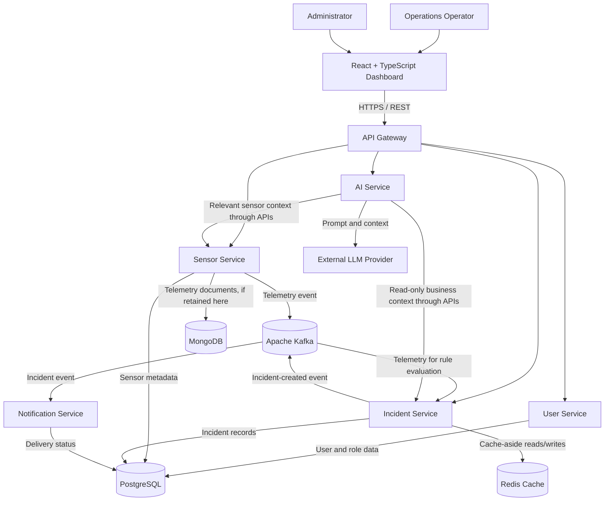

# AquaOps AI — System Architecture

## 1. Document Information

| Field | Value |
|---|---|
| Project Name | AquaOps AI |
| Document | System Architecture |
| Version | 0.1 |
| Status | Initial Draft |
| Related Documents | `docs/00-project-overview.md`, `docs/01-requirements.md` |

## 2. Purpose

This document describes the planned architecture of AquaOps AI, an intelligent water operations and incident management platform.

It explains the major system components, their responsibilities, communication patterns, data ownership, technology choices, security boundaries, and important architectural trade-offs.

The document serves as a technical reference during implementation, testing, deployment, and interview preparation. Architectural decisions will be reviewed and updated as the project evolves.

## 3. System Overview

AquaOps AI is designed to help water operations teams monitor sensors, identify abnormal conditions, manage incidents, notify operators, and investigate incidents with AI-assisted explanations.

The system will accept sensor telemetry, evaluate readings using deterministic business rules, create incidents when configured conditions are met, and make incident information available through a React web dashboard.

An AI assistant will use relevant incident, sensor, and telemetry context to help operators understand situations and plan investigations. AI-generated explanations will support human decision-making rather than replace operational controls or deterministic anomaly detection.

## 4. Architectural Goals

The architecture aims to achieve the following goals:

1. **Clear separation of responsibilities:** Each service owns a defined business capability.
2. **Maintainability:** Components should be understandable, testable, and independently changeable where appropriate.
3. **Reliable processing:** Telemetry and incident events should be processed with explicit retry and failure-handling strategies.
4. **Data integrity:** Transactional business records must remain consistent and authoritative.
5. **Scalability:** Event-processing components should be able to handle increasing workloads without requiring every component to scale identically.
6. **Security:** Access to users, sensors, incidents, and AI capabilities must be controlled and auditable.
7. **Observability:** Logs, metrics, and traces should help diagnose failures and performance problems.
8. **Responsible AI:** AI responses should use relevant evidence, acknowledge uncertainty, and avoid presenting unverified claims as facts.
9. **Practical learning:** The design should demonstrate useful backend, frontend, distributed-systems, cloud, and AI engineering concepts without creating unnecessary complexity.

## 5. Architectural Style

AquaOps AI will use a combination of the following architectural styles:

### 5.1 Service-Oriented Decomposition

The backend will be divided into a small number of services organized around business responsibilities, such as identity, sensor management, incident management, notifications, and AI assistance.

The API Gateway will provide a common entry point for frontend requests.

Services will have explicit responsibilities and controlled communication paths. We will avoid creating a separate service for every small technical function.

### 5.2 Event-Driven Communication

Apache Kafka will support asynchronous communication for selected business events and telemetry-processing workflows.

For example, a telemetry event may trigger anomaly evaluation, and an incident-created event may trigger notification processing.

Event-driven communication will reduce direct dependencies between producers and consumers. It will also introduce distributed-systems concerns such as duplicate delivery, retries, ordering, and eventual consistency, which must be addressed during implementation.

### 5.3 API-Based Communication

HTTP APIs will support interactions that require an immediate response, such as retrieving incidents, updating incident status, managing sensors, and requesting AI assistance.

The API Gateway and backend services will expose documented interfaces with explicit request and response contracts.

## 6. Architecture Status and Scope

This document describes the intended architecture, not a claim that all components have already been implemented.

Technology choices and communication flows will be validated as the project develops. Where a decision has not yet been tested, it will be recorded as a design decision or an assumption rather than presented as a proven result.

Implementation details, deployment topology, database schemas, API specifications, testing strategy, and operational procedures will be documented in their appropriate project documents as those steps are completed.

## 7. High-Level System Architecture

The following diagram shows the planned logical components and the primary communication paths. It is an initial design that will be refined as service contracts and data ownership are defined.

### Diagram notes

- Solid arrows indicate planned communication or data flow, not necessarily synchronous HTTP calls.
- Kafka-based paths are asynchronous.
- PostgreSQL is the authoritative store for transactional business records.
- Redis is a rebuildable cache; PostgreSQL remains authoritative for incidents.
- The telemetry storage design will be evaluated against retention, query, volume, and resource requirements before implementation.
- AI retrieves context through controlled interfaces and does not directly change incident status or independently declare a sensor reading abnormal.