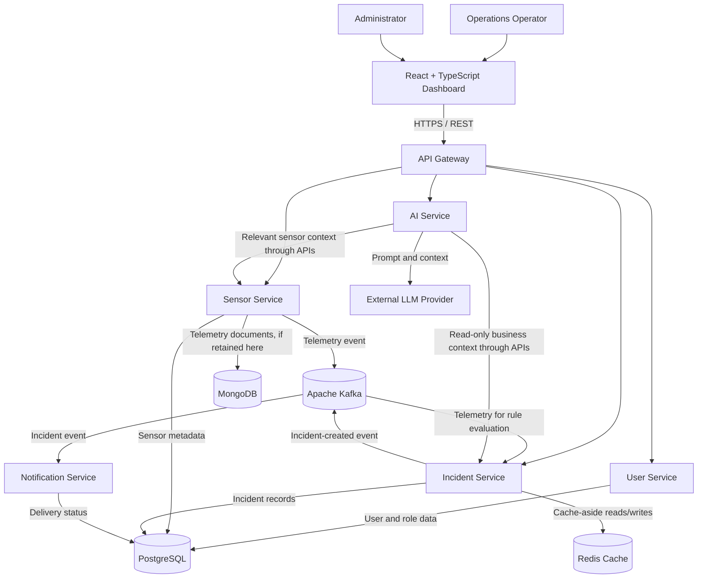
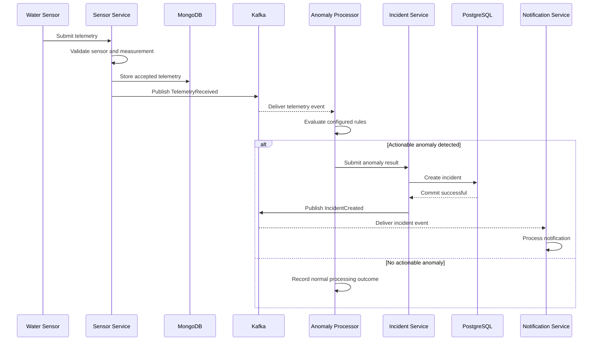
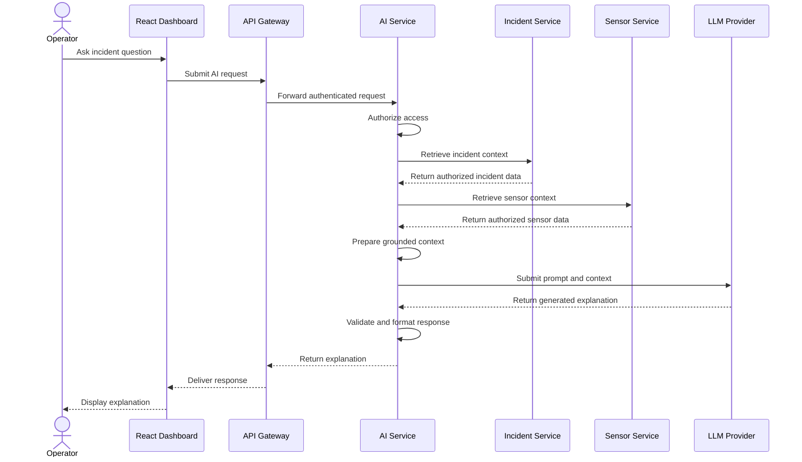

# AquaOps AI — System Architecture

## 1. Document Information

| Field | Value |
|---|---|
| Project Name | AquaOps AI |
| Document | System Architecture |
| Version | 0.1 |
| Status | Initial Draft |
| Related Documents | `docs/00-project-overview.md`, `docs/01-requirements.md` |

## 2. Purpose

This document describes the planned architecture of AquaOps AI, an intelligent water operations and incident management platform.

It explains the major system components, their responsibilities, communication patterns, data ownership, technology choices, security boundaries, and important architectural trade-offs.

The document serves as a technical reference during implementation, testing, deployment, and interview preparation. Architectural decisions will be reviewed and updated as the project evolves.

## 3. System Overview

AquaOps AI is designed to help water operations teams monitor sensors, identify abnormal conditions, manage incidents, notify operators, and investigate incidents with AI-assisted explanations.

The system will accept sensor telemetry, evaluate readings using deterministic business rules, create incidents when configured conditions are met, and make incident information available through a React web dashboard.

An AI assistant will use relevant incident, sensor, and telemetry context to help operators understand situations and plan investigations. AI-generated explanations will support human decision-making rather than replace operational controls or deterministic anomaly detection.

## 4. Architectural Goals

The architecture aims to achieve the following goals:

1. **Clear separation of responsibilities:** Each service owns a defined business capability.
2. **Maintainability:** Components should be understandable, testable, and independently changeable where appropriate.
3. **Reliable processing:** Telemetry and incident events should be processed with explicit retry and failure-handling strategies.
4. **Data integrity:** Transactional business records must remain consistent and authoritative.
5. **Scalability:** Event-processing components should be able to handle increasing workloads without requiring every component to scale identically.
6. **Security:** Access to users, sensors, incidents, and AI capabilities must be controlled and auditable.
7. **Observability:** Logs, metrics, and traces should help diagnose failures and performance problems.
8. **Responsible AI:** AI responses should use relevant evidence, acknowledge uncertainty, and avoid presenting unverified claims as facts.
9. **Practical learning:** The design should demonstrate useful backend, frontend, distributed-systems, cloud, and AI engineering concepts without creating unnecessary complexity.

## 5. Architectural Style

AquaOps AI will use a combination of the following architectural styles:

### 5.1 Service-Oriented Decomposition

The backend will be divided into a small number of services organized around business responsibilities, such as identity, sensor management, incident management, notifications, and AI assistance.

The API Gateway will provide a common entry point for frontend requests.

Services will have explicit responsibilities and controlled communication paths. We will avoid creating a separate service for every small technical function.

### 5.2 Event-Driven Communication

Apache Kafka will support asynchronous communication for selected business events and telemetry-processing workflows.

For example, a telemetry event may trigger anomaly evaluation, and an incident-created event may trigger notification processing.

Event-driven communication will reduce direct dependencies between producers and consumers. It will also introduce distributed-systems concerns such as duplicate delivery, retries, ordering, and eventual consistency, which must be addressed during implementation.

### 5.3 API-Based Communication

HTTP APIs will support interactions that require an immediate response, such as retrieving incidents, updating incident status, managing sensors, and requesting AI assistance.

The API Gateway and backend services will expose documented interfaces with explicit request and response contracts.

## 6. Architecture Status and Scope

This document describes the intended architecture, not a claim that all components have already been implemented.

Technology choices and communication flows will be validated as the project develops. Where a decision has not yet been tested, it will be recorded as a design decision or an assumption rather than presented as a proven result.

Implementation details, deployment topology, database schemas, API specifications, testing strategy, and operational procedures will be documented in their appropriate project documents as those steps are completed.

## 7. High-Level System Architecture

The following diagram shows the planned logical components and the primary communication paths. It is an initial design that will be refined as service contracts and data ownership are defined.



### Diagram notes

- Solid arrows indicate planned communication or data flow, not necessarily synchronous HTTP calls.
- Kafka-based paths are asynchronous.
- PostgreSQL is the authoritative store for transactional business records.
- Redis is a rebuildable cache; PostgreSQL remains authoritative for incidents.
- The telemetry storage design will be evaluated against retention, query, volume, and resource requirements before implementation.
- AI retrieves context through controlled interfaces and does not directly change incident status or independently declare a sensor reading abnormal.

## 8. Component Responsibilities and Boundaries

### 8.1 API Gateway

**Primary responsibility:** Provide a common entry point for frontend API requests.

Responsibilities:
- Route incoming requests to the appropriate backend service.
- Apply shared request-handling policies where appropriate.
- Support centralized rate limiting and request filtering as these capabilities are introduced.
- Propagate authenticated identity and request correlation information securely.

Boundaries:
- Does not own business entities such as users, sensors, or incidents.
- Does not replace authorization checks inside backend services.
- Does not perform anomaly detection or AI reasoning.

### 8.2 User Service

**Primary responsibility:** Manage user-related business data and access-related operations.

Responsibilities:
- Maintain user profiles and account status.
- Manage application roles and role assignments.
- Support user-management operations for authorized administrators.
- Integrate with the chosen authentication design.

Data ownership:
- User profiles, role assignments, and account status will be stored in PostgreSQL.

Boundaries:
- Does not own sensor telemetry or incident lifecycle data.
- Authentication, token issuance, and token validation responsibilities will be finalized in the security design.

### 8.3 Sensor Service

**Primary responsibility:** Manage sensor metadata and accept telemetry measurements.

Responsibilities:
- Register and update sensor metadata.
- Validate incoming telemetry structure, timestamps, and measurement values.
- Associate measurements with known sensors.
- Publish telemetry events to Kafka for downstream processing.
- Expose authorized sensor information to the dashboard and AI Service.

Data ownership:
- Sensor metadata will be stored in PostgreSQL.
- MongoDB is the current candidate for selected telemetry documents, subject to validation of query patterns, retention, and resource requirements.

Boundaries:
- Does not own the incident lifecycle.
- Does not rely on an LLM to decide whether measurements violate configured thresholds.
- Must not publish invalid or unauthenticated device data as trusted telemetry.

### 8.4 Incident Service

**Primary responsibility:** Own incident creation and lifecycle management.

Responsibilities:
- Process anomaly results and create incidents according to deterministic business rules.
- Maintain incident severity, status, assignment, and resolution information.
- Enforce valid incident state transitions.
- Provide APIs for retrieving and updating incidents.
- Publish incident events for downstream consumers.
- Provide authorized incident context to the AI Service.

Data ownership:
- PostgreSQL is the authoritative store for incident records.
- Redis may cache selected frequently accessed data, but cached data can be rebuilt from authoritative sources.

Boundaries:
- Does not send emails directly.
- Does not delegate authoritative incident-state changes to the AI Service.
- Must account for duplicate events and repeated processing.

### 8.5 Notification Service

**Primary responsibility:** Deliver notifications triggered by relevant business events.

Responsibilities:
- Consume configured notification events from Kafka.
- Apply notification preferences and delivery policies.
- Send notifications through the selected delivery provider.
- Track delivery attempts and outcomes.
- Retry transient failures and route exhausted failures for investigation.

Data ownership:
- Notification delivery records and outcomes will be stored in PostgreSQL, subject to the final data model.

Boundaries:
- Does not own incident status.
- A notification failure must not reverse an already committed incident.
- Consumers must handle duplicate event delivery safely.

### 8.6 AI Service

**Primary responsibility:** Provide contextual explanations and investigation assistance.

Responsibilities:
- Authenticate and authorize AI requests.
- Retrieve relevant incident, sensor, and telemetry context through controlled interfaces.
- Construct prompts using relevant evidence.
- Invoke the configured LLM provider through Spring AI.
- Return explanations that distinguish known facts from possible causes.
- Handle provider timeouts, errors, and unavailable context gracefully.

Boundaries:
- Does not independently classify raw telemetry as abnormal.
- Does not directly write to incident records or change incident status.
- Must not disclose information the requesting user is not authorized to access.
- Must communicate uncertainty and avoid presenting unsupported claims as facts.

### 8.7 Data Ownership Principle

Each business service is responsible for the integrity of its own authoritative data.

Other services should access business information through documented APIs or published events rather than directly modifying another service's database tables.

The use of a shared database server during local development does not imply shared ownership of tables. Logical ownership and access boundaries must remain explicit.

### 8.8 Component Evolution

These responsibilities describe the initial design. If implementation reveals that a responsibility is too broad or that a new component is justified, the architecture will be updated through a documented decision rather than splitting services prematurely.

## 9. Communication Patterns and Failure Handling

### 9.1 Synchronous Communication Using REST APIs

HTTP REST APIs will be used when a caller requires an immediate response.

Planned use cases include:
- User authentication and user-management operations.
- Sensor registration and sensor metadata retrieval.
- Incident retrieval and lifecycle updates.
- Dashboard data retrieval.
- AI assistant requests.

REST requests will use documented API contracts, appropriate HTTP methods, validation, authentication, and authorization.

The API Gateway will route frontend requests to the appropriate backend service.

### 9.2 Asynchronous Communication Using Apache Kafka

Apache Kafka will be used for selected event-driven workflows that do not require the producer to wait for downstream processing.

Planned events include:
- TelemetryReceived.
- AnomalyDetected.
- IncidentCreated.
- IncidentUpdated.
- NotificationRequested.

Kafka producers and consumers will communicate through explicitly defined topics and event schemas.

Consumers must be designed to handle retries, duplicate delivery, and temporary unavailability.

### 9.3 REST and Kafka Selection Guidelines

REST will be preferred when:
- The caller needs an immediate response.
- A user is retrieving or updating a resource.
- The operation requires request validation and a direct result.

Kafka will be preferred when:
- A business event needs to be consumed independently by multiple components.
- Background processing is appropriate.
- The producer should not wait for downstream processing.
- Event retention and independent consumer processing are useful.

The choice will be based on business requirements rather than using both technologies unnecessarily.

### 9.4 Kafka Availability Failure

If Kafka is temporarily unavailable, event publishing must not be reported as successful unless the event has been durably accepted.

The system will evaluate a Transactional Outbox Pattern for reliable event publishing.

The outbox approach will store the business transaction and its outgoing event record in the same database transaction. A separate publisher will forward pending events to Kafka.

Publishing failures will be logged, monitored, and retried according to a controlled policy.

### 9.5 Duplicate Event Handling and Idempotency

Kafka consumers must tolerate duplicate event delivery.

Events will include a unique event identifier so consumers can identify previously processed events.

Where processing causes a business side effect, the consumer will use an idempotency mechanism, such as a processed-event record or a unique database constraint.

The design must ensure that duplicate processing does not create duplicate incidents or unintended repeated notifications.

### 9.6 Notification Delivery Failure

Notification delivery is independent of incident creation.

If a notification provider is temporarily unavailable:
- The delivery attempt and failure will be recorded.
- Transient failures will be retried using controlled backoff.
- Maximum retry attempts will be configured.
- Exhausted failures will be routed to a dead-letter mechanism for investigation.
- Delivery status will be observable.

A notification failure must not roll back or reverse an incident that has already been committed.

### 9.7 Redis Cache Failure

Redis will be treated as a non-authoritative cache.

If Redis is unavailable, the Incident Service should attempt to retrieve authoritative incident data from PostgreSQL.

Cache failures will be logged and monitored. The application must not treat missing cache entries as proof that an incident does not exist.

### 9.8 AI Provider Failure

The AI Service will use bounded request timeouts when communicating with external LLM providers.

If the provider is unavailable or returns an error:
- The service will return a clear temporary-unavailability response.
- It will not fabricate an explanation.
- The failure will be logged with request correlation information.
- Normal incident retrieval and management will remain available independently of AI.

AI assistance is optional to the core incident-management workflow.

### 9.9 Security and Authorization Failure

Authentication and authorization will be enforced by backend components.

The API Gateway may perform shared token validation and request filtering, but business services must enforce authorization for operations and data they own.

Unauthorized requests must be rejected. Sensitive data must not be exposed through API responses, logs, events, or AI context retrieval.

### 9.10 Observability and Recovery

The system will progressively introduce:
- Structured application logs.
- Request and event correlation identifiers.
- Service health checks.
- Metrics for request failures, event processing, and notification delivery.
- Monitoring for Kafka consumer lag and retry activity.
- Alerts for persistent failures.

Recovery procedures and operational thresholds will be defined during implementation and deployment.

### 9.11 Failure Handling Principle

Failure in an optional downstream capability must not unnecessarily disable core incident-management functionality.

The system will prioritize durable business records, controlled retries, observable failures, and safe degradation over silently losing data or reporting false success.

## 10. Data Ownership and Database Architecture

### 10.1 Data Ownership Principle

Each business service will own and maintain the authoritative data associated with its responsibility.

Other services must not directly modify another service's database tables or collections.

Services will exchange information through documented APIs and published events.

During local development, multiple services may use the same PostgreSQL server instance, but logical data ownership and access boundaries must remain explicit.

### 10.2 PostgreSQL — Transactional Business Data

PostgreSQL will be used for structured transactional business information.

Planned data includes:
- User profiles and account information.
- Roles and role assignments.
- Sensor metadata and registration information.
- Incident records and lifecycle information.
- Incident assignments and resolution details.
- Notification delivery records.
- Audit information.

Reasons for selecting PostgreSQL:
- Relational data modeling.
- Transaction support.
- Referential integrity and constraints.
- Structured queries and indexing.
- Reliable storage of business records.

PostgreSQL will remain the authoritative source for incident information even when Redis is used as a cache.

### 10.3 MongoDB — Telemetry Document Storage

MongoDB is the current candidate for selected telemetry measurements.

A telemetry document may contain:
- Sensor identifier.
- Measurement timestamp.
- Measurement type.
- Metric values.
- Measurement unit.
- Quality or validation information.

A flexible document structure may be useful when different sensor types produce different measurement attributes.

The final choice will be evaluated using:
- Expected telemetry volume.
- Query and aggregation patterns.
- Retention requirements.
- Indexing requirements.
- Storage and memory requirements.
- Operational complexity.

MongoDB will not automatically become the storage solution for every type of telemetry. The decision will be validated against the actual workload and compared with PostgreSQL alternatives.

### 10.4 Redis — Cache and Temporary State

Redis will be used for selected frequently accessed data where caching provides a measurable performance benefit.

Potential use cases include:
- Frequently accessed active incident summaries.
- Dashboard summary information.
- Short-lived application data.

The cache will use an explicit expiration and invalidation strategy.

Redis will not be treated as the authoritative store for incidents or other transactional business records.

If Redis becomes unavailable, the application should be able to retrieve authoritative information from PostgreSQL where practical.

### 10.5 Apache Kafka — Event Streaming

Kafka will transport asynchronous business events between independent components.

Potential events include:
- TelemetryReceived.
- AnomalyDetected.
- IncidentCreated.
- IncidentUpdated.
- NotificationRequested.

Kafka will provide event retention and independent consumer processing according to configured topic and retention policies.

Kafka will not replace PostgreSQL or MongoDB as the authoritative storage for business records or telemetry queries.

### 10.6 Database Ownership Matrix

| Service or Component | Data | Authoritative Storage |
|---|---|---|
| User Service | Users and roles | PostgreSQL |
| Sensor Service | Sensor metadata | PostgreSQL |
| Sensor Service | Selected telemetry documents | MongoDB, subject to validation |
| Incident Service | Incidents and assignments | PostgreSQL |
| Notification Service | Notification delivery records | PostgreSQL |
| Incident Service | Cached incident information | Redis, non-authoritative |
| Event producers and consumers | Published events | Kafka event topics |

### 10.7 Data Consistency

Each service will maintain transactional consistency within the data it owns.

Cross-service workflows will use asynchronous events where immediate distributed transactions are unnecessary.

This means some information may become visible to downstream services after a short delay. This behavior is known as eventual consistency.

Consumers must handle duplicate events and failures without creating unintended business side effects.

### 10.8 Data Retention and Lifecycle

Data retention policies will be defined according to business, operational, and storage requirements.

The implementation will consider:
- Telemetry retention and archival.
- Incident history retention.
- Notification delivery history.
- Kafka topic retention.
- Cache expiration.
- Backup and recovery requirements.

Retention periods and deletion policies will be finalized before production deployment.

### 10.9 Database Design Principles

The database design will follow these principles:

1. Each service owns its authoritative business data.
2. Database constraints will protect important business invariants.
3. Indexes will support actual query patterns.
4. Sensitive information will be protected.
5. Database migrations will be version-controlled.
6. Cache data must be rebuildable from authoritative sources.
7. Storage technology choices must be justified by actual requirements.

### 10.10 Architectural Trade-offs

Using multiple data technologies introduces additional operational and development complexity.

AquaOps AI will use PostgreSQL, MongoDB, Redis, and Kafka only where their capabilities justify that complexity.

The final implementation will validate resource consumption, performance, maintainability, and reliability before treating the initial choices as permanent.

## 11. End-to-End Business Data Flows

### 11.1 Telemetry-to-Incident Workflow

This workflow describes how a sensor measurement can result in an operational incident.

#### Step 1: Telemetry Submission

A registered water sensor submits a measurement to the Sensor Service.

Example:

```json
{
  "sensorId": "PRESSURE-101",
  "timestamp": "2026-10-07T10:30:00Z",
  "metric": "PRESSURE",
  "value": 7.8,
  "unit": "bar"
}
```

The example value and timestamp are illustrative.

#### Step 2: Telemetry Validation

The Sensor Service validates:
- Sensor identity and registration.
- Required fields.
- Measurement type and unit.
- Timestamp validity.
- Measurement format and acceptable data constraints.

Invalid or unauthenticated measurements must not be treated as trusted telemetry.

#### Step 3: Telemetry Persistence

Accepted telemetry is stored according to the selected telemetry storage strategy.

MongoDB is the current candidate for selected telemetry documents, subject to workload and retention validation.

#### Step 4: Telemetry Event Publication

The Sensor Service publishes a TelemetryReceived event to Kafka.

The event contains the information required by downstream consumers and includes a unique event identifier.

#### Step 5: Anomaly Evaluation

A deterministic anomaly-processing component evaluates the measurement against configured thresholds and business rules.

The initial implementation will use explicit rules rather than an LLM to decide whether a measurement is abnormal.

#### Step 6: Incident Creation

When a configured rule identifies an actionable anomaly, the Incident Service creates an incident in PostgreSQL.

The incident includes relevant sensor information, measurement evidence, severity, and creation time.

Incident creation must account for duplicate event processing and existing active incidents according to the defined business rules.

#### Step 7: Incident Event Publication

After the incident is committed, an IncidentCreated event is published to Kafka.

Reliable publication will be implemented using an appropriate mechanism, with the Transactional Outbox Pattern evaluated for this workflow.

#### Step 8: Notification Processing

The Notification Service consumes the incident event and initiates the configured notification process.

Delivery attempts and outcomes are recorded independently of incident creation.

#### Step 9: Dashboard Retrieval

The React dashboard requests incident information through the API Gateway.

The Incident Service retrieves authoritative data from PostgreSQL, optionally using Redis for eligible cached information.

#### Step 10: Operator Investigation

The operator opens the incident and may request an AI-generated explanation.

The AI Service retrieves authorized evidence and generates a contextual response.

### 11.2 Telemetry-to-Incident Sequence Diagram



### 11.3 Operator-to-AI Investigation Workflow

This workflow describes how an authorized operator requests an explanation of an existing incident.

#### Step 1: Operator Request

The operator selects an incident in the React dashboard and submits a question.

Example:

"Why was INC-1001 classified as critical?"

#### Step 2: API Gateway

The API Gateway routes the request to the AI Service after applying the configured edge-level security controls.

#### Step 3: Authorization

The AI Service validates the requesting identity and checks whether the operator is authorized to access the requested information.

#### Step 4: Context Retrieval

The AI Service retrieves relevant incident, sensor, and telemetry information through controlled interfaces.

Only information the requesting user is permitted to access may be included in the AI context.

#### Step 5: Context Preparation

The AI Service prepares a structured context containing verified information, relevant measurement history, and the operator's question.

#### Step 6: LLM Invocation

Spring AI is used to communicate with the configured LLM provider.

#### Step 7: Response Validation

The service evaluates the response for appropriate structure and presentation.

The response must distinguish available evidence from possible explanations and acknowledge missing information or uncertainty.

#### Step 8: Response Delivery

The AI Service returns the explanation through the API Gateway to the React dashboard.

The AI response is advisory and does not directly modify authoritative incident records.

### 11.4 Operator-to-AI Sequence Diagram



### 11.5 Business Flow Guarantees

The implementation should preserve these principles:

1. Invalid telemetry must not become trusted operational evidence.
2. Incident records must be committed before downstream notification processing is considered successful.
3. Duplicate events must not create unintended duplicate incidents or notifications.
4. Notification failure must not reverse an existing incident.
5. AI provider failure must not prevent normal incident retrieval and management.
6. AI explanations must be based on authorized context and must not be treated as authoritative operational decisions.
7. Each workflow must expose enough logging and correlation information for investigation.

## 12. Security Architecture

### 12.1 Purpose

The purpose of the security architecture is to protect AquaOps AI users, sensors, services, business data, and AI capabilities from unauthorized access, misuse, and data exposure.

Security must be enforced across the complete application rather than relying only on frontend restrictions or API Gateway validation.

### 12.2 Security Principles

The system follows these security principles:

- Least Privilege: Every user and service receives only the permissions required for its responsibilities.
- Defense in Depth: Security controls are implemented at multiple layers.
- Secure by Default: Protected resources require authentication and authorization.
- Backend Enforcement: Business permissions are enforced by backend services.
- Secret Protection: Passwords, tokens, API keys, and credentials must not be exposed in source code or logs.
- Data Minimization: Components should access only the data required to perform their responsibilities.
- Auditability: Important security-sensitive operations should be recorded for investigation.

### 12.3 User Authentication

AquaOps AI uses email and password authentication for its initial user login workflow.

The User Service is responsible for:

- Validating user credentials.
- Retrieving the corresponding user account.
- Verifying the submitted password against its stored password hash.
- Issuing a signed JWT access token after successful authentication.
- Rejecting invalid credentials.
- Applying account-related security rules.

Plain-text passwords must never be stored in the database.

Passwords will be stored using a dedicated password-hashing algorithm such as BCrypt or Argon2.

### 12.4 Token-Based Authentication

JWT access tokens are used to authenticate subsequent API requests.

After successful authentication:

1. The User Service validates the user's credentials.
2. The User Service issues a signed access token.
3. The frontend sends the token with protected API requests.
4. The API Gateway validates the token.
5. The receiving backend service applies its authorization rules.

Protected API requests use the standard Authorization header:

    Authorization: Bearer <access-token>

JWT tokens must be validated for signature, expiration, and applicable issuer and audience requirements.

Sensitive information such as passwords, API secrets, and private credentials must never be included in JWT payloads.

The access-token lifetime, refresh-token strategy, and frontend token-storage approach will be finalized during implementation.

### 12.5 Role-Based Access Control

AquaOps AI uses Role-Based Access Control (RBAC) to manage user permissions.

Initial roles:

| Role | Responsibilities |
|---|---|
| ADMIN | Manage users, roles, sensors, and system configuration |
| MANAGER | Monitor operations, assign incidents, and review operational performance |
| OPERATOR | Monitor assigned incidents and perform permitted incident actions |

Authorization decisions must be enforced by backend services.

The frontend may hide unavailable actions to improve usability, but frontend restrictions must never be considered a security boundary.

### 12.6 API Gateway Security

The API Gateway acts as the main entry point for frontend API requests.

Its security responsibilities include:

- Validating authentication tokens.
- Rejecting requests with invalid or expired tokens.
- Applying appropriate request-level security controls.
- Routing authorized requests to backend services.
- Propagating authenticated identity information through trusted mechanisms.
- Supporting rate limiting where appropriate.

The API Gateway does not replace authorization checks inside backend services.

### 12.7 Backend Service Authorization

Each backend service is responsible for protecting its own business operations.

Examples:

- User Service controls user and role management.
- Sensor Service controls sensor registration and sensor-related operations.
- Incident Service verifies permissions before incident assignment, acknowledgement, or resolution.
- Notification Service protects notification operations and delivery records.
- AI Service verifies whether the requesting user is allowed to access the requested incident and its associated context.

Services must not assume that a request is authorized merely because it originated from another internal service.

### 12.8 Service-to-Service Security

Internal communication between backend services must be authenticated.

The initial implementation will use a controlled service-to-service authentication mechanism.

Service credentials must be stored securely and must not be committed to Git.

Future deployment improvements may include stronger workload identity and mutual TLS where justified by operational requirements.

### 12.9 Sensor Authentication and Trust

Sensors are external data producers and must not be treated as automatically trusted.

The Sensor Service must verify that incoming telemetry originates from a registered and authorized sensor.

Initial security measures include:

- Unique credentials for registered sensors.
- Credential validation during telemetry submission.
- Secure credential storage.
- Credential rotation and revocation support.
- Validation that a sensor is permitted to submit data.

Invalid or unauthorized telemetry submissions must be rejected and appropriately logged.

### 12.10 AI Security and Data Access

The AI Service must operate within the authorization boundaries of the main application.

Security requirements include:

- Verify the requesting user's identity.
- Verify permission to access the requested incident.
- Retrieve only the incident and telemetry context that the user is authorized to access.
- Avoid exposing credentials or unrelated sensitive information to the LLM provider.
- Treat retrieved documents and external content as untrusted input.
- Validate AI responses before returning them to the user.

The AI Service must not independently grant permissions or bypass the authorization rules of the Incident Service.

AI-generated recommendations remain advisory and cannot directly modify authoritative incident status.

### 12.11 Secrets and Configuration Management

Sensitive configuration must not be hardcoded into application source code.

Examples include:

- Database passwords.
- JWT signing secrets or private keys.
- Kafka credentials.
- Redis credentials.
- Sensor credentials.
- LLM provider API keys.

During local development, secrets will be supplied through local environment configuration that is excluded from Git.

In production, managed secret storage will be used where supported by the deployment environment.

Secret rotation must be considered for credentials that can be compromised or expire.

### 12.12 Transport and Data Protection

Communication containing credentials, tokens, or sensitive application data must use HTTPS/TLS in deployed environments.

Additional protections include:

- Secure password hashing.
- Restricted database access.
- Appropriate access controls for infrastructure components.
- Avoiding sensitive information in application logs.
- Protecting backups and stored data.
- Restricting access to operational and audit records.

### 12.13 Security Logging and Auditing

Important security-related events should be recorded.

Examples include:

- Successful and failed login attempts.
- Token validation failures.
- Unauthorized access attempts.
- User and role changes.
- Sensor credential failures.
- Sensitive incident operations.
- Administrative configuration changes.

Logs must not contain plain-text passwords, access tokens, signing secrets, or other sensitive credentials.

### 12.14 Security Responsibilities

| Component | Security responsibility |
|---|---|
| React Frontend | Send authentication tokens securely and present permitted actions |
| API Gateway | Validate tokens and apply gateway-level security controls |
| User Service | Authenticate users and manage user roles |
| Sensor Service | Validate registered sensor identities |
| Incident Service | Enforce incident-level authorization |
| Notification Service | Protect notification operations and records |
| AI Service | Enforce authorized context retrieval and protect sensitive AI inputs |
| Infrastructure | Protect databases, Kafka, Redis, secrets, and network communication |

### 12.15 Security Design Principles

The security architecture follows these rules:

1. Authentication and authorization are separate responsibilities.
2. Backend services enforce business authorization.
3. The API Gateway is not the only security boundary.
4. Passwords are never stored in plain text.
5. Secrets are never committed to source control.
6. Sensors must be authenticated before submitting trusted telemetry.
7. AI must not bypass application authorization.
8. Sensitive credentials must not appear in logs.
9. Internal service communication must be authenticated.
10. Security controls must be tested as part of application development.

### 12.16 Future Security Enhancements

Potential future enhancements include:

- Multi-factor authentication.
- Mutual TLS for internal service communication.
- More granular permissions and organization-level access isolation.
- Advanced sensor identity management.
- Centralized audit and security monitoring.
- Automated vulnerability scanning.
- Secret rotation automation.
- Advanced API rate limiting and abuse detection.

These enhancements will be evaluated according to project requirements and deployment needs.

### 12.17 Architecture Status

Status: Initial security architecture documented.

Implementation of authentication, JWT validation, RBAC, sensor authentication, and service-to-service security will be completed during backend development.

## 13. Architecture Trade-offs and Technology Decisions

### 13.1 Purpose

This section documents the reasoning behind major architectural and technology choices in AquaOps AI.

Technology selection must consider functional requirements, operational complexity, scalability, reliability, maintainability, development effort, and project objectives.

No technology is considered universally superior. Each selection involves benefits, limitations, and trade-offs.

### 13.2 Microservices vs Monolithic Architecture

**Decision:** Use a small, domain-oriented microservices architecture.

**Context:**

AquaOps AI contains several business responsibilities, including user management, sensor telemetry, incident management, notification delivery, and AI-assisted investigation.

These responsibilities have different workflows and operational requirements.

**Alternatives considered:**

1. Monolithic application.
2. Modular monolith.
3. Microservices architecture.

**Rationale:**

Microservices allow the main business responsibilities to be developed and deployed independently.

They also provide practical experience with:

- Service boundaries.
- Independent deployment.
- Distributed communication.
- Event-driven architecture.
- Failure isolation.
- Service-level observability.

**Consequences and trade-offs:**

Benefits:
- Independent service development and deployment.
- Clearer business responsibility boundaries.
- Independent scaling where necessary.
- Better demonstration of distributed-system concepts.

Costs:
- More infrastructure and configuration.
- Network communication failures.
- Distributed data consistency challenges.
- More complicated debugging and testing.
- Increased deployment and monitoring effort.

**Scope control:**

The architecture will contain five business services and one API Gateway.

Small responsibilities will remain inside the appropriate business service unless there is a clear technical or business reason to extract them.

A modular monolith would be a reasonable alternative for a smaller production application. Microservices are selected here because of the project's learning objectives and the need to demonstrate distributed-system design.

### 13.3 REST vs Kafka

**Decision:** Use REST for synchronous request/response communication and Kafka for asynchronous event distribution.

**Context:**

Different workflows require different communication patterns.

For example, the frontend needs immediate responses when requesting incident information, while telemetry and incident events may need to be processed by multiple independent consumers.

**Alternatives considered:**

1. REST-only communication.
2. Kafka-only communication.
3. Combined REST and event-driven communication.
4. Other messaging systems such as RabbitMQ.

**Rationale:**

REST is appropriate for:
- User login and API requests.
- Retrieving incident information.
- Sensor registration.
- Operator actions.
- Immediate request/response workflows.

Kafka is appropriate for:
- Telemetry event distribution.
- Incident-created events.
- Notification processing.
- Asynchronous integration between services.
- Independent event consumers.

**Consequences and trade-offs:**

REST provides straightforward request/response behavior but can introduce runtime dependencies between communicating services.

Kafka reduces direct runtime coupling between event producers and consumers but introduces broker operations, consumer management, duplicate processing, and eventual consistency.

Kafka consumers must be designed to handle duplicate event delivery through idempotent processing.

Reliable event publishing may use the Transactional Outbox Pattern where required.

Kafka will not replace REST for ordinary API operations.

### 13.4 PostgreSQL vs MongoDB

**Decision:** PostgreSQL is the authoritative relational database. MongoDB remains a candidate for selected telemetry documents.

**Context:**

AquaOps AI stores transactional business records and sensor telemetry.

These data categories have different structures and access patterns.

**Alternatives considered:**

1. PostgreSQL only.
2. MongoDB only.
3. PostgreSQL and MongoDB together.
4. PostgreSQL with a suitable time-series extension or other specialized storage, if justified later.

**Rationale:**

PostgreSQL is selected for authoritative business data because it provides relational integrity, transactions, constraints, and SQL capabilities.

Examples:
- Users and roles.
- Sensor metadata.
- Incidents and assignments.
- Notification records.
- Audit records.

MongoDB may be suitable for selected telemetry documents where flexible document structures and document-oriented queries provide a meaningful advantage.

**Consequences and trade-offs:**

PostgreSQL provides a strong transactional foundation but may require deliberate schema and indexing decisions as telemetry volume grows.

MongoDB provides flexible document storage but introduces another database to deploy, secure, monitor, back up, and maintain.

Using two databases also increases operational and data consistency complexity.

**Validation requirement:**

MongoDB will not be treated as mandatory until the telemetry access patterns, volume, indexing requirements, retention strategy, and operational costs have been evaluated.

PostgreSQL alone remains a valid initial implementation if it satisfies the project requirements.

### 13.5 Redis vs Direct Database Access

**Decision:** Use Redis as an optional, rebuildable cache.

**Context:**

Frequently requested data may be read repeatedly, increasing load on PostgreSQL.

**Alternatives considered:**

1. Direct PostgreSQL access for every request.
2. Redis caching.
3. Application-level in-memory caching.

**Rationale:**

Redis can reduce repeated database reads for frequently accessed information.

The initial caching strategy will use the cache-aside pattern:

1. Application checks Redis.
2. If the key exists, the cached value is returned.
3. If the key does not exist, the application reads PostgreSQL.
4. The application places the retrieved value into Redis.
5. Subsequent requests may use the cached value.

**Consequences and trade-offs:**

Benefits:
- Faster repeated reads.
- Reduced database load.
- Configurable expiration through TTL.

Costs:
- Cache invalidation complexity.
- Potentially stale values.
- Additional infrastructure.
- Memory usage and operational overhead.

PostgreSQL remains the authoritative source of business data.

Redis failure must not result in loss of authoritative records. Supported reads should fall back to PostgreSQL.

### 13.6 Deterministic Anomaly Detection vs AI-Based Detection

**Decision:** Use deterministic anomaly rules for the initial incident-detection workflow and AI for advisory investigation.

**Context:**

Water operations require predictable incident creation and traceable detection logic.

An AI model may produce variable responses and can become unavailable because of external provider or network failures.

**Alternatives considered:**

1. Rule-based anomaly detection.
2. AI-only anomaly detection.
3. Combined deterministic detection and AI-assisted investigation.

**Rationale:**

Deterministic rules provide:
- Predictable thresholds.
- Repeatable test cases.
- Explainable detection conditions.
- Auditable incident creation.

AI provides:
- Natural-language incident explanations.
- Contextual summaries.
- Suggested investigation steps.
- Assistance in understanding operational patterns.

**Consequences and trade-offs:**

Rule-based detection may require manual threshold configuration and may not recognize every complex pattern.

AI may provide useful explanations but can produce incorrect or unsupported responses.

Therefore:

- Deterministic logic remains responsible for initial anomaly detection.
- Incident Service remains responsible for authoritative incident lifecycle operations.
- AI provides advisory assistance.
- AI must not directly create, resolve, or change authoritative incident status without an explicitly designed and authorized workflow.

### 13.7 API Gateway vs Direct Service Exposure

**Decision:** Use an API Gateway as the primary entry point for frontend API traffic.

**Context:**

The frontend should not need to manage the internal network locations and routing details of individual backend services.

**Alternatives considered:**

1. Frontend directly communicates with every service.
2. Central API Gateway.
3. Gateway combined with service-level authorization.

**Rationale:**

The gateway provides a centralized entry point for routing, token validation, and selected cross-cutting controls.

Backend services continue to own their business authorization and validation.

**Consequences and trade-offs:**

Benefits:
- Simplified frontend integration.
- Centralized routing.
- Consistent gateway-level security controls.

Costs:
- Additional infrastructure.
- Potential bottleneck if poorly configured.
- Gateway availability becomes important.
- Gateway configuration requires careful maintenance.

The gateway must not become the sole security boundary.

### 13.8 Architecture Decision Summary

| Decision | Selected approach | Important trade-off |
|---|---|---|
| Application architecture | Small microservices architecture | Distributed-system complexity |
| Frontend communication | REST through API Gateway | Gateway dependency |
| Asynchronous communication | Kafka | Broker and consumer operations |
| Transactional storage | PostgreSQL | Schema and query design |
| Telemetry storage | MongoDB candidate | Additional database overhead |
| Caching | Redis | Cache invalidation and staleness |
| Anomaly detection | Deterministic rules | Threshold maintenance |
| AI assistance | Advisory AI with authorized context | Model variability and provider dependency |
| User security | JWT and RBAC | Token lifecycle and authorization complexity |

### 13.9 Decision Review Principles

Architecture decisions must be reviewed when:

- Business requirements change.
- Performance testing reveals limitations.
- Infrastructure costs become significant.
- A technology introduces unnecessary operational complexity.
- Security requirements change.
- An alternative provides a measurable improvement.

Technology choices must be justified by requirements and evidence rather than popularity.

### 13.10 Architecture Status

Status: Initial architecture trade-offs documented.

The detailed decisions are recorded in the Architecture Decision Records under `docs/decisions/`.

Some decisions, particularly the need for MongoDB and the exact caching strategy, remain subject to implementation and workload validation.


## 14. Final Architecture Review

### 14.1 Review Purpose

This section records the final review of the initial AquaOps AI architecture before detailed database design and implementation.

The review checks whether the documented components, communication patterns, data ownership, business workflows, security responsibilities, and failure-handling principles are consistent.

### 14.2 Architecture Review Areas

The architecture review covers:

- Business service responsibilities and boundaries.
- API Gateway responsibilities.
- REST and Kafka communication patterns.
- PostgreSQL, MongoDB, Redis, and Kafka data responsibilities.
- Telemetry-to-incident workflow.
- Operator-to-AI investigation workflow.
- Authentication and authorization.
- Service-to-service and sensor authentication.
- Failure handling and recovery.
- Architecture trade-offs and Architecture Decision Records.

### 14.3 Confirmed Architecture Principles

The initial architecture follows these principles:

1. Five business services and one API Gateway form the initial backend structure.
2. REST handles synchronous request/response communication.
3. Kafka handles asynchronous event distribution.
4. PostgreSQL remains authoritative for transactional business records.
5. MongoDB remains conditional on telemetry workload validation.
6. Redis is an optional, rebuildable caching layer.
7. Incident detection uses deterministic rules.
8. AI provides advisory investigation assistance.
9. Backend services enforce business authorization.
10. Cross-service workflows account for eventual consistency and failure scenarios.
11. Services own their authoritative business data.
12. Infrastructure and service complexity must remain appropriate to project requirements.

### 14.4 Items to Validate During Implementation

The following details require practical implementation and testing:

- Exact database schemas and service-specific database arrangements.
- Whether MongoDB is necessary for telemetry.
- Kafka topic configuration, partition strategy, and retention.
- Reliable event publication and idempotent consumption.
- Cache keys, TTL values, and invalidation rules.
- JWT lifecycle and refresh-token strategy.
- Service-to-service authentication.
- Sensor credential management.
- Performance, resource usage, and deployment configuration.
- AI context retrieval, response validation, and provider failure handling.

These details must not be treated as fully implemented or performance-validated merely because they are documented.

### 14.5 Architecture Decision Records

The initial architecture decisions are recorded in:

| ADR | Decision |
|---|---|
| ADR-001 | Project architecture |
| ADR-002 | Database choice |
| ADR-003 | Kafka choice |
| ADR-004 | Redis choice |

The decisions will be reviewed when implementation evidence or changing requirements justify revisions.

### 14.6 Review Outcome

The initial architecture documentation and its major technology decisions have been reviewed for consistency.

Status: Initial architecture review completed, subject to implementation validation.

The next project phase is detailed database design, followed by incremental implementation and testing.