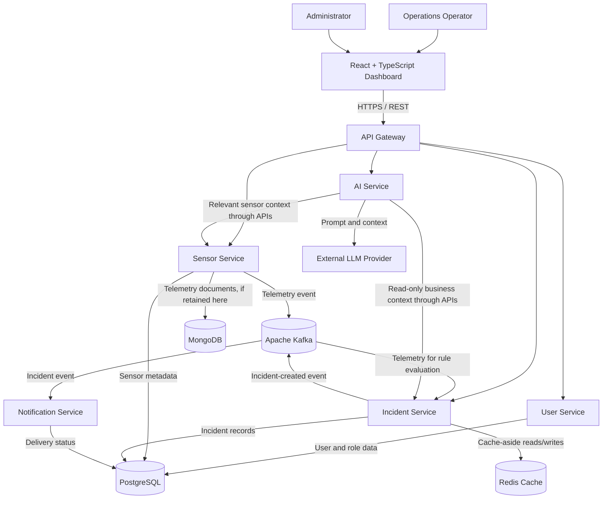

# AquaOps AI — System Architecture

## 1. Document Information

| Field | Value |
|---|---|
| Project Name | AquaOps AI |
| Document | System Architecture |
| Version | 0.1 |
| Status | Initial Draft |
| Related Documents | `docs/00-project-overview.md`, `docs/01-requirements.md` |

## 2. Purpose

This document describes the planned architecture of AquaOps AI, an intelligent water operations and incident management platform.

It explains the major system components, their responsibilities, communication patterns, data ownership, technology choices, security boundaries, and important architectural trade-offs.

The document serves as a technical reference during implementation, testing, deployment, and interview preparation. Architectural decisions will be reviewed and updated as the project evolves.

## 3. System Overview

AquaOps AI is designed to help water operations teams monitor sensors, identify abnormal conditions, manage incidents, notify operators, and investigate incidents with AI-assisted explanations.

The system will accept sensor telemetry, evaluate readings using deterministic business rules, create incidents when configured conditions are met, and make incident information available through a React web dashboard.

An AI assistant will use relevant incident, sensor, and telemetry context to help operators understand situations and plan investigations. AI-generated explanations will support human decision-making rather than replace operational controls or deterministic anomaly detection.

## 4. Architectural Goals

The architecture aims to achieve the following goals:

1. **Clear separation of responsibilities:** Each service owns a defined business capability.
2. **Maintainability:** Components should be understandable, testable, and independently changeable where appropriate.
3. **Reliable processing:** Telemetry and incident events should be processed with explicit retry and failure-handling strategies.
4. **Data integrity:** Transactional business records must remain consistent and authoritative.
5. **Scalability:** Event-processing components should be able to handle increasing workloads without requiring every component to scale identically.
6. **Security:** Access to users, sensors, incidents, and AI capabilities must be controlled and auditable.
7. **Observability:** Logs, metrics, and traces should help diagnose failures and performance problems.
8. **Responsible AI:** AI responses should use relevant evidence, acknowledge uncertainty, and avoid presenting unverified claims as facts.
9. **Practical learning:** The design should demonstrate useful backend, frontend, distributed-systems, cloud, and AI engineering concepts without creating unnecessary complexity.

## 5. Architectural Style

AquaOps AI will use a combination of the following architectural styles:

### 5.1 Service-Oriented Decomposition

The backend will be divided into a small number of services organized around business responsibilities, such as identity, sensor management, incident management, notifications, and AI assistance.

The API Gateway will provide a common entry point for frontend requests.

Services will have explicit responsibilities and controlled communication paths. We will avoid creating a separate service for every small technical function.

### 5.2 Event-Driven Communication

Apache Kafka will support asynchronous communication for selected business events and telemetry-processing workflows.

For example, a telemetry event may trigger anomaly evaluation, and an incident-created event may trigger notification processing.

Event-driven communication will reduce direct dependencies between producers and consumers. It will also introduce distributed-systems concerns such as duplicate delivery, retries, ordering, and eventual consistency, which must be addressed during implementation.

### 5.3 API-Based Communication

HTTP APIs will support interactions that require an immediate response, such as retrieving incidents, updating incident status, managing sensors, and requesting AI assistance.

The API Gateway and backend services will expose documented interfaces with explicit request and response contracts.

## 6. Architecture Status and Scope

This document describes the intended architecture, not a claim that all components have already been implemented.

Technology choices and communication flows will be validated as the project develops. Where a decision has not yet been tested, it will be recorded as a design decision or an assumption rather than presented as a proven result.

Implementation details, deployment topology, database schemas, API specifications, testing strategy, and operational procedures will be documented in their appropriate project documents as those steps are completed.

## 7. High-Level System Architecture

The following diagram shows the planned logical components and the primary communication paths. It is an initial design that will be refined as service contracts and data ownership are defined.

### Diagram notes

- Solid arrows indicate planned communication or data flow, not necessarily synchronous HTTP calls.
- Kafka-based paths are asynchronous.
- PostgreSQL is the authoritative store for transactional business records.
- Redis is a rebuildable cache; PostgreSQL remains authoritative for incidents.
- The telemetry storage design will be evaluated against retention, query, volume, and resource requirements before implementation.
- AI retrieves context through controlled interfaces and does not directly change incident status or independently declare a sensor reading abnormal.

## 8. Component Responsibilities and Boundaries

### 8.1 API Gateway

**Primary responsibility:** Provide a common entry point for frontend API requests.

Responsibilities:
- Route incoming requests to the appropriate backend service.
- Apply shared request-handling policies where appropriate.
- Support centralized rate limiting and request filtering as these capabilities are introduced.
- Propagate authenticated identity and request correlation information securely.

Boundaries:
- Does not own business entities such as users, sensors, or incidents.
- Does not replace authorization checks inside backend services.
- Does not perform anomaly detection or AI reasoning.

### 8.2 User Service

**Primary responsibility:** Manage user-related business data and access-related operations.

Responsibilities:
- Maintain user profiles and account status.
- Manage application roles and role assignments.
- Support user-management operations for authorized administrators.
- Integrate with the chosen authentication design.

Data ownership:
- User profiles, role assignments, and account status will be stored in PostgreSQL.

Boundaries:
- Does not own sensor telemetry or incident lifecycle data.
- Authentication, token issuance, and token validation responsibilities will be finalized in the security design.

### 8.3 Sensor Service

**Primary responsibility:** Manage sensor metadata and accept telemetry measurements.

Responsibilities:
- Register and update sensor metadata.
- Validate incoming telemetry structure, timestamps, and measurement values.
- Associate measurements with known sensors.
- Publish telemetry events to Kafka for downstream processing.
- Expose authorized sensor information to the dashboard and AI Service.

Data ownership:
- Sensor metadata will be stored in PostgreSQL.
- MongoDB is the current candidate for selected telemetry documents, subject to validation of query patterns, retention, and resource requirements.

Boundaries:
- Does not own the incident lifecycle.
- Does not rely on an LLM to decide whether measurements violate configured thresholds.
- Must not publish invalid or unauthenticated device data as trusted telemetry.

### 8.4 Incident Service

**Primary responsibility:** Own incident creation and lifecycle management.

Responsibilities:
- Process anomaly results and create incidents according to deterministic business rules.
- Maintain incident severity, status, assignment, and resolution information.
- Enforce valid incident state transitions.
- Provide APIs for retrieving and updating incidents.
- Publish incident events for downstream consumers.
- Provide authorized incident context to the AI Service.

Data ownership:
- PostgreSQL is the authoritative store for incident records.
- Redis may cache selected frequently accessed data, but cached data can be rebuilt from authoritative sources.

Boundaries:
- Does not send emails directly.
- Does not delegate authoritative incident-state changes to the AI Service.
- Must account for duplicate events and repeated processing.

### 8.5 Notification Service

**Primary responsibility:** Deliver notifications triggered by relevant business events.

Responsibilities:
- Consume configured notification events from Kafka.
- Apply notification preferences and delivery policies.
- Send notifications through the selected delivery provider.
- Track delivery attempts and outcomes.
- Retry transient failures and route exhausted failures for investigation.

Data ownership:
- Notification delivery records and outcomes will be stored in PostgreSQL, subject to the final data model.

Boundaries:
- Does not own incident status.
- A notification failure must not reverse an already committed incident.
- Consumers must handle duplicate event delivery safely.

### 8.6 AI Service

**Primary responsibility:** Provide contextual explanations and investigation assistance.

Responsibilities:
- Authenticate and authorize AI requests.
- Retrieve relevant incident, sensor, and telemetry context through controlled interfaces.
- Construct prompts using relevant evidence.
- Invoke the configured LLM provider through Spring AI.
- Return explanations that distinguish known facts from possible causes.
- Handle provider timeouts, errors, and unavailable context gracefully.

Boundaries:
- Does not independently classify raw telemetry as abnormal.
- Does not directly write to incident records or change incident status.
- Must not disclose information the requesting user is not authorized to access.
- Must communicate uncertainty and avoid presenting unsupported claims as facts.

### 8.7 Data Ownership Principle

Each business service is responsible for the integrity of its own authoritative data.

Other services should access business information through documented APIs or published events rather than directly modifying another service's database tables.

The use of a shared database server during local development does not imply shared ownership of tables. Logical ownership and access boundaries must remain explicit.

### 8.8 Component Evolution

These responsibilities describe the initial design. If implementation reveals that a responsibility is too broad or that a new component is justified, the architecture will be updated through a documented decision rather than splitting services prematurely.

## 9. Communication Patterns and Failure Handling

### 9.1 Synchronous Communication Using REST APIs

HTTP REST APIs will be used when a caller requires an immediate response.

Planned use cases include:
- User authentication and user-management operations.
- Sensor registration and sensor metadata retrieval.
- Incident retrieval and lifecycle updates.
- Dashboard data retrieval.
- AI assistant requests.

REST requests will use documented API contracts, appropriate HTTP methods, validation, authentication, and authorization.

The API Gateway will route frontend requests to the appropriate backend service.

### 9.2 Asynchronous Communication Using Apache Kafka

Apache Kafka will be used for selected event-driven workflows that do not require the producer to wait for downstream processing.

Planned events include:
- TelemetryReceived.
- AnomalyDetected.
- IncidentCreated.
- IncidentUpdated.
- NotificationRequested.

Kafka producers and consumers will communicate through explicitly defined topics and event schemas.

Consumers must be designed to handle retries, duplicate delivery, and temporary unavailability.

### 9.3 REST and Kafka Selection Guidelines

REST will be preferred when:
- The caller needs an immediate response.
- A user is retrieving or updating a resource.
- The operation requires request validation and a direct result.

Kafka will be preferred when:
- A business event needs to be consumed independently by multiple components.
- Background processing is appropriate.
- The producer should not wait for downstream processing.
- Event retention and independent consumer processing are useful.

The choice will be based on business requirements rather than using both technologies unnecessarily.

### 9.4 Kafka Availability Failure

If Kafka is temporarily unavailable, event publishing must not be reported as successful unless the event has been durably accepted.

The system will evaluate a Transactional Outbox Pattern for reliable event publishing.

The outbox approach will store the business transaction and its outgoing event record in the same database transaction. A separate publisher will forward pending events to Kafka.

Publishing failures will be logged, monitored, and retried according to a controlled policy.

### 9.5 Duplicate Event Handling and Idempotency

Kafka consumers must tolerate duplicate event delivery.

Events will include a unique event identifier so consumers can identify previously processed events.

Where processing causes a business side effect, the consumer will use an idempotency mechanism, such as a processed-event record or a unique database constraint.

The design must ensure that duplicate processing does not create duplicate incidents or unintended repeated notifications.

### 9.6 Notification Delivery Failure

Notification delivery is independent of incident creation.

If a notification provider is temporarily unavailable:
- The delivery attempt and failure will be recorded.
- Transient failures will be retried using controlled backoff.
- Maximum retry attempts will be configured.
- Exhausted failures will be routed to a dead-letter mechanism for investigation.
- Delivery status will be observable.

A notification failure must not roll back or reverse an incident that has already been committed.

### 9.7 Redis Cache Failure

Redis will be treated as a non-authoritative cache.

If Redis is unavailable, the Incident Service should attempt to retrieve authoritative incident data from PostgreSQL.

Cache failures will be logged and monitored. The application must not treat missing cache entries as proof that an incident does not exist.

### 9.8 AI Provider Failure

The AI Service will use bounded request timeouts when communicating with external LLM providers.

If the provider is unavailable or returns an error:
- The service will return a clear temporary-unavailability response.
- It will not fabricate an explanation.
- The failure will be logged with request correlation information.
- Normal incident retrieval and management will remain available independently of AI.

AI assistance is optional to the core incident-management workflow.

### 9.9 Security and Authorization Failure

Authentication and authorization will be enforced by backend components.

The API Gateway may perform shared token validation and request filtering, but business services must enforce authorization for operations and data they own.

Unauthorized requests must be rejected. Sensitive data must not be exposed through API responses, logs, events, or AI context retrieval.

### 9.10 Observability and Recovery

The system will progressively introduce:
- Structured application logs.
- Request and event correlation identifiers.
- Service health checks.
- Metrics for request failures, event processing, and notification delivery.
- Monitoring for Kafka consumer lag and retry activity.
- Alerts for persistent failures.

Recovery procedures and operational thresholds will be defined during implementation and deployment.

### 9.11 Failure Handling Principle

Failure in an optional downstream capability must not unnecessarily disable core incident-management functionality.

The system will prioritize durable business records, controlled retries, observable failures, and safe degradation over silently losing data or reporting false success.

## 10. Data Ownership and Database Architecture

### 10.1 Data Ownership Principle

Each business service will own and maintain the authoritative data associated with its responsibility.

Other services must not directly modify another service's database tables or collections.

Services will exchange information through documented APIs and published events.

During local development, multiple services may use the same PostgreSQL server instance, but logical data ownership and access boundaries must remain explicit.

### 10.2 PostgreSQL — Transactional Business Data

PostgreSQL will be used for structured transactional business information.

Planned data includes:
- User profiles and account information.
- Roles and role assignments.
- Sensor metadata and registration information.
- Incident records and lifecycle information.
- Incident assignments and resolution details.
- Notification delivery records.
- Audit information.

Reasons for selecting PostgreSQL:
- Relational data modeling.
- Transaction support.
- Referential integrity and constraints.
- Structured queries and indexing.
- Reliable storage of business records.

PostgreSQL will remain the authoritative source for incident information even when Redis is used as a cache.

### 10.3 MongoDB — Telemetry Document Storage

MongoDB is the current candidate for selected telemetry measurements.

A telemetry document may contain:
- Sensor identifier.
- Measurement timestamp.
- Measurement type.
- Metric values.
- Measurement unit.
- Quality or validation information.

A flexible document structure may be useful when different sensor types produce different measurement attributes.

The final choice will be evaluated using:
- Expected telemetry volume.
- Query and aggregation patterns.
- Retention requirements.
- Indexing requirements.
- Storage and memory requirements.
- Operational complexity.

MongoDB will not automatically become the storage solution for every type of telemetry. The decision will be validated against the actual workload and compared with PostgreSQL alternatives.

### 10.4 Redis — Cache and Temporary State

Redis will be used for selected frequently accessed data where caching provides a measurable performance benefit.

Potential use cases include:
- Frequently accessed active incident summaries.
- Dashboard summary information.
- Short-lived application data.

The cache will use an explicit expiration and invalidation strategy.

Redis will not be treated as the authoritative store for incidents or other transactional business records.

If Redis becomes unavailable, the application should be able to retrieve authoritative information from PostgreSQL where practical.

### 10.5 Apache Kafka — Event Streaming

Kafka will transport asynchronous business events between independent components.

Potential events include:
- TelemetryReceived.
- AnomalyDetected.
- IncidentCreated.
- IncidentUpdated.
- NotificationRequested.

Kafka will provide event retention and independent consumer processing according to configured topic and retention policies.

Kafka will not replace PostgreSQL or MongoDB as the authoritative storage for business records or telemetry queries.

### 10.6 Database Ownership Matrix

| Service or Component | Data | Authoritative Storage |
|---|---|---|
| User Service | Users and roles | PostgreSQL |
| Sensor Service | Sensor metadata | PostgreSQL |
| Sensor Service | Selected telemetry documents | MongoDB, subject to validation |
| Incident Service | Incidents and assignments | PostgreSQL |
| Notification Service | Notification delivery records | PostgreSQL |
| Incident Service | Cached incident information | Redis, non-authoritative |
| Event producers and consumers | Published events | Kafka event topics |

### 10.7 Data Consistency

Each service will maintain transactional consistency within the data it owns.

Cross-service workflows will use asynchronous events where immediate distributed transactions are unnecessary.

This means some information may become visible to downstream services after a short delay. This behavior is known as eventual consistency.

Consumers must handle duplicate events and failures without creating unintended business side effects.

### 10.8 Data Retention and Lifecycle

Data retention policies will be defined according to business, operational, and storage requirements.

The implementation will consider:
- Telemetry retention and archival.
- Incident history retention.
- Notification delivery history.
- Kafka topic retention.
- Cache expiration.
- Backup and recovery requirements.

Retention periods and deletion policies will be finalized before production deployment.

### 10.9 Database Design Principles

The database design will follow these principles:

1. Each service owns its authoritative business data.
2. Database constraints will protect important business invariants.
3. Indexes will support actual query patterns.
4. Sensitive information will be protected.
5. Database migrations will be version-controlled.
6. Cache data must be rebuildable from authoritative sources.
7. Storage technology choices must be justified by actual requirements.

### 10.10 Architectural Trade-offs

Using multiple data technologies introduces additional operational and development complexity.

AquaOps AI will use PostgreSQL, MongoDB, Redis, and Kafka only where their capabilities justify that complexity.

The final implementation will validate resource consumption, performance, maintainability, and reliability before treating the initial choices as permanent.